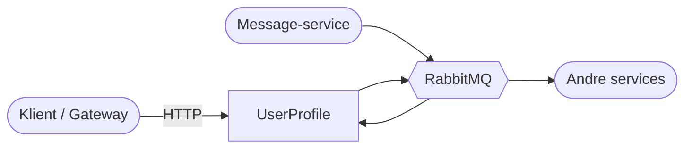

# 1. System-kontekst

Servicen ejer brugerprofiler (brugernavn, navn, email, bio, avatar-URL) og en tæller over brugerens beskeder.

- **HTTP:** Klienter opretter, læser, opdaterer og sletter profiler.
- **RabbitMQ:** Servicen modtager `MessagePostedEvent` fra Message-servicen og sender events ud, når noget ændrer sig.

**I forhold til scope-tegningen:** User-delen er lavet. Databasen er midlertidigt in-memory i stedet for MSSQL.
Avatar, Relationship og API Gateway mangler.
