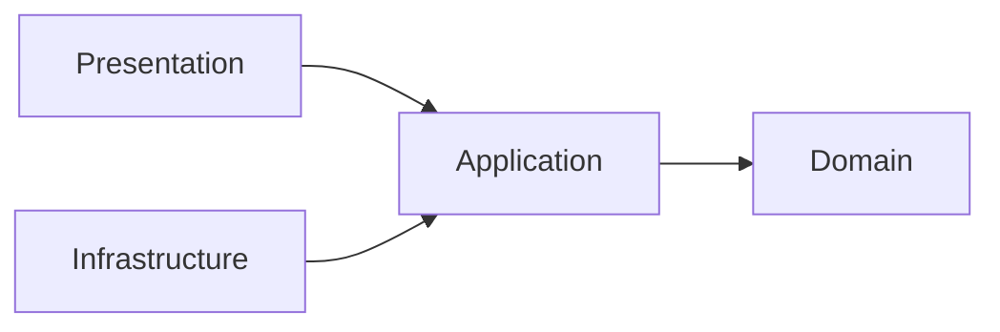

# 3. Clean Architecture

Servicen har fire lag. Afhængigheder peger kun indad mod Domain.

| Lag | Ansvar |
|---|---|
| **Domain** | `UserProfile` og reglerne for en gyldig profil. Kender intet til HTTP, database eller RabbitMQ |
| **Application** | Use cases (`UserProfileService`). Definerer interfaces til lagring og events |
| **Infrastructure** | Implementerer interfacene: repository, publicering af events og consumer af beskeder |
| **Presentation** | Controller, `Program.cs`, og oversættelse af fejl til HTTP-statuskoder |
