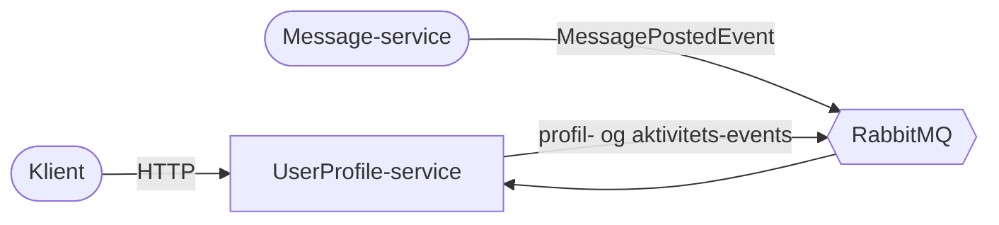

# Arkitektur: UserProfile-microservice

En .NET-service, der gemmer brugerprofiler og tæller hvor mange beskeder hver bruger har skrevet.
Den har et REST-API og taler med andre services via RabbitMQ.

1. [System-kontekst](01-system-context.md)
2. [Repository-struktur](02-repository-structure.md)
3. [Clean Architecture](03-clean-architecture.md)
4. [Domænemodel](04-domain-model.md)
5. [HTTP-flows](05-http-flows.md)
6. [Messaging](06-messaging.md)
7. [Packages](07-packages.md)
8. [Deployment og test](08-deployment-and-testing.md)
9. [Begrænsninger og roadmap](09-limitations-and-roadmap.md)
